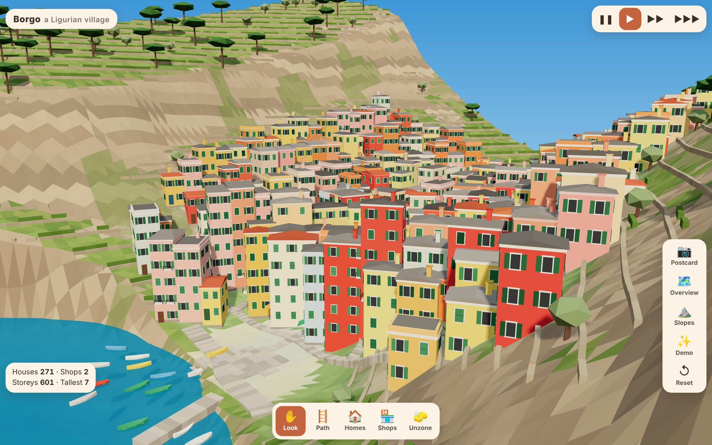

# Borgo — a cozy Ligurian village builder (prototype)

A browser prototype of a city-builder inspired by Riomaggiore and the Cinque Terre.
You never place buildings: you lay **stairs and lanes** and paint **zones**, and the
village grows by itself. Houses pack tightly, share walls, step up the hillside and get
taller toward the harbour.

Plain HTML + JavaScript modules. Three.js comes from a CDN, so there's nothing to install
and no build step.

---

## Running it

You need **Python 3** (already on macOS and Linux; on Windows install it from
python.org or the Microsoft Store). A local server is needed because browsers block
JavaScript modules opened straight from a file.

1. Open a terminal in this folder.
2. Run:
   - macOS / Linux: `python3 serve.py`
   - Windows: `py serve.py`
3. Open the **"On this computer"** address it prints (usually http://localhost:8000).

The first load needs internet access, to fetch Three.js from the CDN.

**No Python?** If you have Node.js, `npx serve .` works too.

### On your phone (same Wi-Fi)

1. Start the server on your computer as above.
2. On the phone, open the **"On your phone"** address it prints, e.g. `http://192.168.1.23:8000`.
3. If it doesn't load:
   - check that both devices are on the same Wi-Fi network (not a guest network);
   - on Windows, allow Python through the firewall when asked (Private networks);
   - on macOS, click "Allow" if asked about incoming connections.

---

## How to play

| Tool | What it does |
|---|---|
| ✋ **Look** | Drag to orbit · pinch / scroll to zoom · two fingers or right-drag to pan |
| 🪜 **Path** | Tap the ground to drop waypoints, then **Finish path**. Start at the harbour quay (or on an existing path) so it's connected. Steep climbs zig-zag automatically. Dragging still orbits the camera. |
| 🏠 **Homes** / 🏪 **Shops** | Paint zones with one finger (or left mouse). Bright = connected to the harbour, faded = not reachable yet. Pinch still zooms; on desktop, right-drag rotates. |
| 🧽 **Unzone** | Rub zoning out. |
| ▶ ▶▶ ▶▶▶ | Growth speed (❚❚ pauses). |
| 📷 **Postcard** | Glide to the classic view from the water. |
| ⛰️ **Slopes** | Shows the slope bands: green flat, yellow moderate, orange steep, red cliff (nothing grows there). |
| ✨ **Demo** | Lays out a sample village (paths + zones). Press ▶▶▶ and watch it grow. |
| ↺ **Reset** | Clears everything. |

**Quick start:** press ✨ Demo, then ▶▶▶, then 📷 Postcard.

---

## How it works

| File | Role |
|---|---|
| `index.html` | Page, styles, toolbar, import map for Three.js |
| `src/config.js` | **All tunable numbers** (slope bands, sizes, effort weights, speeds, colours) |
| `src/terrain.js` | Procedural cove (heightfield), slope bands, smoothed "downhill" field |
| `src/water.js` | Animated low-poly sea and boats |
| `src/camera.js` | Orbit camera, ground-collision clamp, postcard view |
| `src/paths.js` | Stairs/lanes: switchback routing, the path graph, stone-step rendering |
| `src/zones.js` | Zone painting on a hidden 2 m grid, soft overlay |
| `src/access.js` | Walking effort (Dijkstra over paths, then onto the ground) |
| `src/growth.js` | **The growth simulation** (placement, scoring, storeys) |
| `src/buildings.js` | Instanced low-poly houses: walls, roofs, windows, shutters, balconies… |
| `src/scenery.js` | Dry-stone terraces, vines and trees |
| `src/demo.js` | The sample village layout |
| `src/ui.js` | Tools, touch/mouse handling, hints |

### Growth in one paragraph

Each house is an oriented rectangle whose facade faces downhill (from a smoothed slope
field) and whose width runs along the contour. Floors are counted from the **uphill**
ground, and the walls extend down to the lowest ground, so downhill facades are taller.
New houses mostly **attach** to existing ones:
- a side neighbour hinges on the shared front corner, so the two share a wall and the
  row follows the contour;
- an uphill neighbour sits back-to-back, so the rows step up the slope;
- if the full-size house doesn't fit, it shrinks to fill the gap.

Sometimes a new house straddles a lane instead: it stands on two piers with the stair or
passage running underneath (an archway), which helps the rows merge into one mass.

Along the harbour front, footprints are slimmer and houses reach up to 8 storeys. A narrow
quay walkway, a small piazza and a slipway are always kept open.

A brand-new cluster can only start right beside a connected path. Every candidate must sit
on zoned, reachable, non-cliff land. The best-scoring one gets built: low walking effort,
touching many neighbours, plus a little randomness. Meanwhile, houses gain storeys toward
a target set by how close they are to the harbour (in effort), local density and the
slope band (steep = small houses only).

The look is tuned mainly through `src/config.js`:
- `terrain.ravine`: shape of the ravine (floor width, flank slopes, where the cliffs start);
- `slope`: the slope bands (moderate < 33°, steep < 42°, cliff above);
- `harbour`: quay, piazza, slipway, the waterfront's slim tall houses;
- `path`: lane width, clearance, archways;
- `building`: sizes, storeys, roof pitch.

`docs/progress/` holds before/after screenshots for each tuning step.

The browser console has a few helpers:
- `game.demo()` lays out the demo village;
- `game.growth.grow(500)` runs 500 growth steps instantly;
- `game.rig.postcard()` flies to the postcard view.
